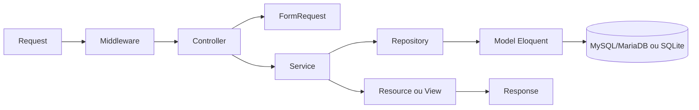

# Arquitetura

MoreSpaces usa MVC em camadas. A camada HTTP recebe e valida a requisição, a
camada de aplicação concentra regras de negócio e a camada de dados encapsula
o Eloquent. Controllers não executam consultas nem decidem regras de negócio.

## Fluxo de uma requisição

O `FormRequest` é resolvido pelo container antes da execução do método do
controller; no diagrama ele aparece depois do controller para mostrar que a
entrada validada é o contrato usado por ele. Em ações de leitura, o
controller chama o service, que chama o repository e devolve uma View ou
Resource.

## Responsabilidades por pasta

| Pasta | Responsabilidade |
|---|---|
| `routes/` | Mapeia URLs, verbos HTTP e middleware para controllers. |
| `app/Http/Controllers/` | Coordena a requisição e escolhe View, redirect ou JSON. |
| `app/Http/Requests/` | Autoriza a operação e valida payloads HTTP. |
| `app/Http/Resources/` | Define o formato público dos recursos da API. |
| `app/Http/Middleware/` | Sessão, papéis, CSRF, headers e contexto de logs. |
| `app/Services/` | Sanitização, regras de negócio, transações e eventos de domínio. |
| `app/Repositories/` | Consultas e gravações através de contratos e Eloquent. |
| `app/Models/` | Mapeia tabelas, casts, relações e mass assignment. |
| `app/Policies/` | Autoriza ações por usuário e papel. |
| `app/Enums/` | Valores fechados de papel e classificação de perigo. |
| `database/` | Migrations, factories e seeders reproduzíveis. |
| `resources/views/` | Interface Blade HTML. |
| `tests/` | Testes unitários, feature, segurança e integração. |
| `docs/` | Contratos e decisões que explicam o sistema. |

## Registros de decisão

### Sessão em vez de JWT

O site é uma aplicação web Blade com formulários e cookies, portanto a sessão
nativa do Laravel integra autenticação, logout, regeneração de sessão e CSRF
sem criar um mecanismo de refresh/revogação de tokens. A API v1 reutiliza
intencionalmente essa sessão web; não há bearer token nem armazenamento de JWT.

### Repositories

Repositories isolam consultas Eloquent dos services e permitem testar regras de
negócio com doubles de um contrato. Eles também mantêm busca, paginação e
persistência em um único lugar, evitando consultas duplicadas em controllers.

### Página temática de 403

A área M.G.E faz parte da narrativa visual do produto. Uma resposta HTML 403
com a página “Não há arquivos disponíveis” comunica a restrição sem revelar
detalhes internos; requisições JSON continuam recebendo um envelope
padronizado com status 403.

### API reutiliza services

Web e API executam as mesmas regras de sanitização, unicidade, validação de
domínio, persistência e logs por meio de `LevelService` e `ContactService`.
Somente a apresentação muda: Blade/redirect no web e Resource/JSON na API.
Isso evita que os dois canais evoluam com regras diferentes.
