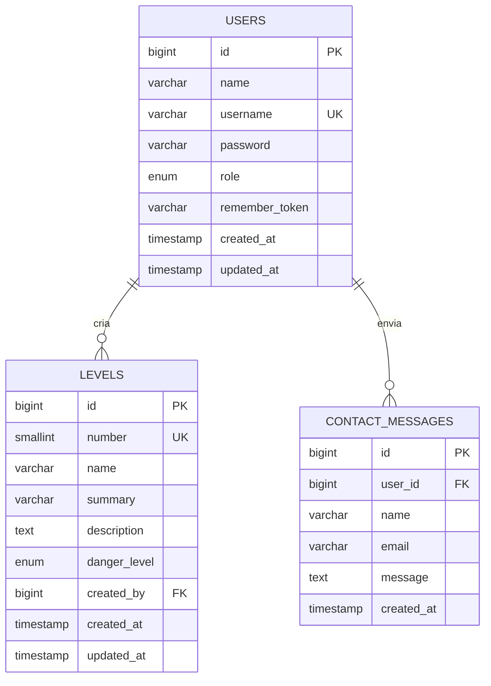

# Banco de dados

O banco usa as migrations do Laravel e mantém a sessão em banco. Senhas são
armazenadas somente como hashes; o valor original nunca é persistido. Em
produção, a aplicação deve usar credenciais definidas fora do repositório.

## Diagrama ER

## Entidades

### `users`

| Coluna | Tipo | Restrição | Motivo |
|---|---|---|---|
| `id` | BIGINT UNSIGNED | PK | Identifica o usuário. |
| `name` | VARCHAR(120) | NOT NULL | Nome exibido. |
| `username` | VARCHAR(30) | NOT NULL, UNIQUE | Login curto e sem duplicidade. |
| `password` | VARCHAR(255) | NOT NULL | Acomoda hashes seguros. |
| `role` | ENUM | NOT NULL, DEFAULT `member` | Perfil de acesso controlado. |
| `remember_token` | VARCHAR(100) | NULL | Suporte ao login persistente do Laravel. |
| `created_at`, `updated_at` | TIMESTAMP | NULL | Auditoria temporal padrão. |

### `levels`

| Coluna | Tipo | Restrição | Motivo |
|---|---|---|---|
| `id` | BIGINT UNSIGNED | PK | Identifica o nível. |
| `number` | SMALLINT UNSIGNED | NOT NULL, UNIQUE | Número não negativo e único. |
| `name` | VARCHAR(120) | NOT NULL | Nome do nível. |
| `summary` | VARCHAR(255) | NULL | Resumo opcional para listagens. |
| `description` | TEXT | NOT NULL | Conteúdo completo do nível. |
| `danger_level` | ENUM | NOT NULL, DEFAULT `moderate` | Classificação válida de risco. |
| `created_by` | BIGINT UNSIGNED | FK, NULL, `ON DELETE SET NULL` | Preserva o nível se o autor for removido. |
| `created_at`, `updated_at` | TIMESTAMP | NULL | Auditoria temporal. |

### `contact_messages`

| Coluna | Tipo | Restrição | Motivo |
|---|---|---|---|
| `id` | BIGINT UNSIGNED | PK | Identifica a mensagem. |
| `user_id` | BIGINT UNSIGNED | FK, NULL, `ON DELETE SET NULL` | Liga mensagens a usuários sem exigir login. |
| `name` | VARCHAR(120) | NOT NULL | Nome informado no contato. |
| `email` | VARCHAR(190) | NOT NULL | Endereço para resposta. |
| `message` | TEXT | NOT NULL | Conteúdo da solicitação. |
| `created_at` | TIMESTAMP | NOT NULL, DEFAULT CURRENT_TIMESTAMP | Ordenação e auditoria do recebimento. |

### `sessions`

| Coluna | Tipo | Restrição | Motivo |
|---|---|---|---|
| `id` | VARCHAR(255) | PK | Identifica a sessão. |
| `user_id` | BIGINT UNSIGNED | NULL | Associação opcional mantida pelo driver de sessão. |
| `ip_address` | VARCHAR(45) | NULL | IPv4 ou IPv6. |
| `user_agent` | TEXT | NULL | Metadados do cliente. |
| `payload` | TEXT | NOT NULL | Estado serializado da sessão. |
| `last_activity` | INT | NOT NULL, INDEX | Limpeza e consulta por atividade. |

## Índices

- `users.username` (UNIQUE): impede contas duplicadas e acelera a busca de login.
- `users.role` (INDEX): acelera filtros por perfil e suporta autorização.
- `levels.number` (UNIQUE): impede níveis repetidos e acelera consulta por número.
- `levels.danger_level` (INDEX): acelera filtros por classificação de risco.
- `levels.created_by` (INDEX): acelera consultas dos níveis criados por um usuário.
- `contact_messages.created_at` (INDEX): acelera listagens cronológicas e triagem.
- `sessions.last_activity`: índice exigido pelo driver para localizar sessões antigas.
